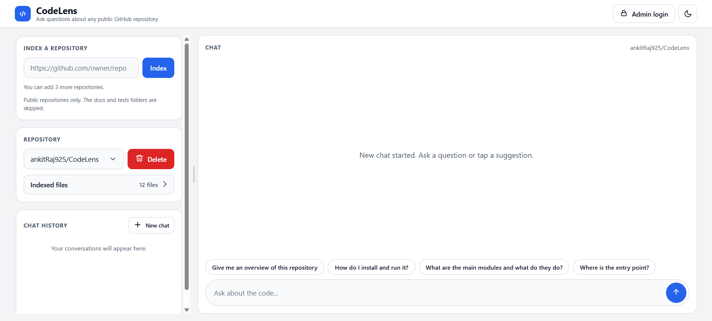
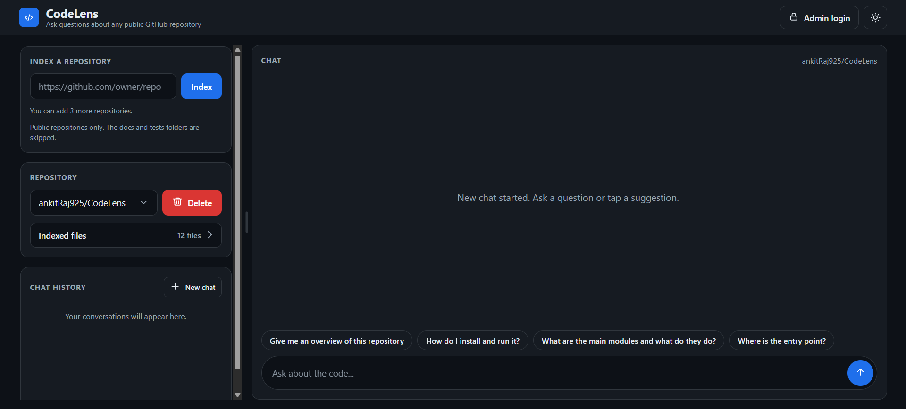
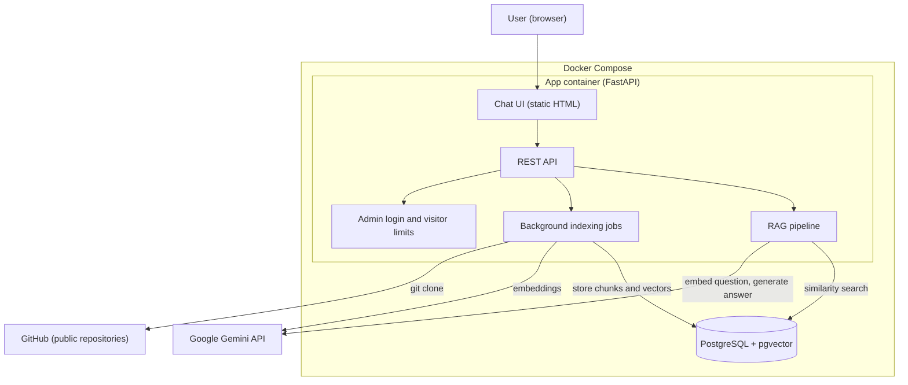
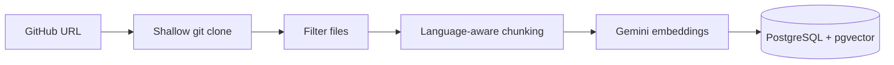
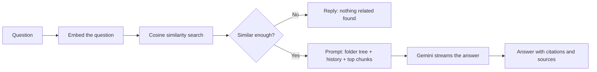

# CodeLens

    

> *Ask questions about any public GitHub repository and get answers with citations, file names and line numbers.*

**A Retrieval-Augmented Generation (RAG) app for codebases.** Paste a public GitHub URL, ask questions in plain English, and get streaming answers with exact file paths, line numbers and direct GitHub links.

🌐 **Live Demo:** [Open CodeLens](https://codelens-md10.onrender.com) · *Free hosting, so the first load after inactivity can take about a minute.*

## 🧭 Table of Contents

- [✨ Features](#-features)
- [📸 Screenshots](#-screenshots)
- [🧱 Architecture](#-architecture)
- [🧠 How It Works](#-how-it-works)
- [👥 Access Model](#-access-model)
- [🧰 Technology Stack](#-technology-stack)
- [📁 Project Structure](#-project-structure)
- [🚀 Getting Started](#-getting-started)
- [🔧 Configuration](#-configuration)
- [🌐 Deployment](#-deployment)
- [⚡ Keyboard Shortcuts](#-keyboard-shortcuts)
- [🔌 API Reference](#-api-reference)
- [🧩 Design Decisions](#-design-decisions)
- [🚧 Limitations](#-limitations)
- [🔮 Future Improvements](#-future-improvements)
- [📄 License](#-license)
- [👤 Author](#-author)

## ✨ Features

- **Index any public repository** from its GitHub URL, with a live progress bar.
- **Language-aware chunking:** code is split along function and class boundaries, not at random positions.
- **Answers with sources:** every answer lists the files and line numbers it used, with one-click links to GitHub.
- **Streaming answers** with a Stop button.
- **Conversation memory:** follow-up questions like "explain that in simpler words" work.
- **Chat history:** past conversations are saved in your browser and listed in a sidebar. You can reopen, continue or delete them, and drag the divider to resize the sidebar.
- **Folder tree context:** the model also sees the repository structure, so layout questions get useful answers.
- **Hallucination control:** the model answers only from retrieved code, and a similarity threshold skips the model call when nothing relevant is found.
- **Example repositories:** the admin picks repositories that every visitor can explore immediately.
- **Visitor workspace without sign-up:** each visitor can add up to three repositories of their own, with a live counter of how many are left.
- **Shared indexing:** a repository that is already indexed is reused, so it costs no extra API calls.
- **Admin login:** one password unlocks full control, including showing or hiding repositories for visitors with a single click.
- **Polished interface:** dark and light themes, responsive layout, markdown rendering, copy buttons and keyboard shortcuts.
- **One-command setup** with Docker Compose.

## 📸 Screenshots

<table>
  <tr>
    <td align="center"><b>Light mode</b><br></td>
    <td align="center"><b>Dark mode</b><br></td>
  </tr>
</table>

<p align="center">
  <b>An answer with numbered citations and sources</b><br>
  
</p>

## 🧱 Architecture



<p align="justify">
Locally, both containers run with Docker Compose. In the live demo, the app runs on Render and the database runs on Neon.
</p>

## 🧠 How It Works

**1. Ingestion (once per repository)**



**2. Question answering (every question)**



<p align="justify">
In plain words: the repository is cut into small pieces, and each piece is turned into a list of numbers (an embedding) that captures its meaning. A question is turned into numbers the same way, and the database finds the pieces whose meaning is closest. Only those pieces are sent to the language model, which is told to answer from them and nothing else.
</p>

## 👥 Access Model

| | Admin | Visitor |
|---|---|---|
| **Sign-in** | Password | None, an anonymous browser cookie |
| **Can see** | All repositories | Example repositories and their own |
| **Indexing** | No limits (up to 1500 chunks per repository) | Up to 3 repositories, each up to 400 chunks |
| **Deleting** | Any repository | Only their own repositories |
| **Questions** | No limit | 15 per hour, and a daily cap for all visitors together |
| **Data lifetime** | Permanent | Their own repositories are removed after 24 hours |

<p align="justify">
The admin decides which repositories are examples with the eye icon in the repository list: an open eye means visitors can see it, a crossed eye means admin only. A visitor cannot delete an example. The visitor counter ("You can add N more repositories") drops as soon as indexing starts, and deleting a repository does not give the slot back. Indexing new repositories is also capped per IP address and per day, to protect the API quota.
</p>

## 🧰 Technology Stack

<p align="center">
  
  <br>
  
</p>

<details>
<summary>Technology details</summary>

| Layer | Technology | Used for |
|---|---|---|
| Backend | Python 3.11, FastAPI, Uvicorn | REST API, streaming responses, background jobs |
| Chunking | LangChain text splitters | Language-aware splitting of source code |
| AI | Google Gemini (`google-genai`) | Embeddings and answer generation |
| Database | PostgreSQL 16 with pgvector | Vector storage, HNSW index, cosine similarity search, ownership and limits |
| Data access | SQLAlchemy, psycopg 3 | Queries and transactions |
| Access control | Signed cookies | Admin login and anonymous visitor sessions |
| Repository access | Git, GitPython | Shallow clone of public repositories from GitHub |
| Frontend | HTML, CSS, JavaScript | Chat interface served by FastAPI, no build step |
| Packaging | Docker, Docker Compose | One-command local setup |
| Hosting | Render, Neon | Docker web service for the app, serverless PostgreSQL with pgvector for the data |

</details>

## 📁 Project Structure

```
CodeLens/
├── app/
│   ├── main.py        # FastAPI routes and streaming responses
│   ├── config.py      # Settings loaded from environment variables
│   ├── auth.py        # Admin login, signed cookies, visitor sessions
│   ├── limits.py      # Visitor question and indexing limits
│   ├── db.py          # Tables, vector search, ownership, usage counters
│   ├── loader.py      # URL validation, git clone, file filtering
│   ├── chunker.py     # Language-aware splitting with line numbers
│   ├── embedder.py    # Gemini embeddings with batching and retries
│   ├── indexer.py     # Background indexing jobs and progress
│   ├── rag.py         # Retrieval, prompt building, answer streaming
│   ├── smalltalk.py   # Local replies to greetings (no API call)
│   └── static/
│       └── index.html # Chat interface
├── db/init.sql        # Enables the pgvector extension
├── docs/screenshots/  # Images used in this README
├── Dockerfile
├── docker-compose.yml
├── requirements.txt
└── .env.example
```

## 🚀 Getting Started

**Prerequisites**

- [Docker Desktop](https://www.docker.com/products/docker-desktop/) (running)
- [Git](https://git-scm.com/)
- A free Gemini API key from [Google AI Studio](https://aistudio.google.com/apikey)

**Run it locally**

```bash
git clone https://github.com/ankitRaj925/CodeLens.git
cd CodeLens
```

Create your environment file (Windows PowerShell: `copy .env.example .env`, macOS/Linux: `cp .env.example .env`) and set your values:

```
POSTGRES_USER=codelens
POSTGRES_PASSWORD=choose_a_password
POSTGRES_DB=codelens
GOOGLE_API_KEY=your_gemini_api_key
```

Start everything:

```bash
docker compose up --build
```

Open **http://localhost:8000**, paste a public GitHub URL, press **Enter**, and start asking questions. Interactive API docs are at http://localhost:8000/docs.

<p align="justify">
With no admin password set, you are the admin on your own machine: there are no limits, and every repository you index is visible to you. To try the visitor experience, add <code>ADMIN_PASSWORD=choose_a_password</code> to <code>.env</code> and run <code>docker compose up -d</code>. You will then be a visitor until you click <b>Admin login</b>.
</p>

To stop the app, press `Ctrl + C` and run `docker compose down`. Indexed data is kept in a Docker volume; add `-v` only if you want to delete it.

## 🔧 Configuration

| Variable | Purpose |
|---|---|
| `POSTGRES_USER`, `POSTGRES_PASSWORD`, `POSTGRES_DB` | Credentials for the local database container |
| `DATABASE_URL` | Connection string of a hosted PostgreSQL database (used in deployment; Docker Compose builds it for you locally) |
| `GOOGLE_API_KEY` | Your Gemini API key |
| `ADMIN_PASSWORD` | Admin password. Leave it empty for local use. It is required in production |
| `SECRET_KEY` | Secret used to sign the admin cookie. Falls back to the admin password |

<p align="justify">
Visitor limits (repositories per visitor, chunks per repository, questions per hour, data lifetime and more) live in <code>app/config.py</code> and can be overridden with environment variables such as <code>VISITOR_MAX_REPOS</code>. The model names live in code: <code>EMBEDDING_MODEL</code> in <code>app/embedder.py</code> and <code>CHAT_MODEL</code> in <code>app/rag.py</code>. Google renames models from time to time, so if you see a "model not found" error, check the <a href="https://ai.google.dev/gemini-api/docs/models">current model list</a> and update those two lines.
</p>

## 🌐 Deployment

<p align="justify">
The live demo runs on <b>Render</b>, which builds the app from the <code>Dockerfile</code>, and uses <b>Neon</b> as the PostgreSQL database. Both are on free plans.
</p>

1. **Neon:** create a project and copy the connection string with connection pooling switched off. It ends with `?sslmode=require`. The app enables the `vector` extension by itself.
2. **Render:** create a new Web Service from the GitHub repository, choose **Docker** as the language, pick the free instance type, and set the health check path to `/health`.
3. **Environment variables on Render:** `DATABASE_URL`, `GOOGLE_API_KEY`, `ADMIN_PASSWORD` and `SECRET_KEY`.
4. **First run:** open the site, click **Admin login**, index a few repositories, and use the eye icon to show them to visitors as examples.

<p align="justify">
Render provides the port through the <code>PORT</code> variable, and the Dockerfile uses it. On Render the app refuses to start without <code>ADMIN_PASSWORD</code>, so a configuration mistake can never turn every visitor into an admin. Free instances sleep after a period of inactivity, so the first request after a break can take about a minute. Secrets are set in the Render dashboard and never committed to Git.
</p>

## ⚡ Keyboard Shortcuts

| Key | Action |
|---|---|
| `Enter` | Index a repository / send a question |
| `Up` / `Down` | Move between the input boxes |
| `/` | Focus the question box |
| `Esc` | Stop a streaming answer |
| `Alt + N` | New chat |
| `Alt + T` | Toggle theme |
| `E` | In the repository list (admin): show or hide the highlighted repository for visitors |
| `Left` / `Right` | On the sidebar divider: resize the sidebar |

## 🔌 API Reference

| Method | Endpoint | Description |
|---|---|---|
| `GET` | `/` | Chat page |
| `GET` | `/health` | Checks the database, pgvector and API key |
| `POST` | `/admin/login` | Logs the admin in and sets a signed cookie. Wrong passwords are rate limited |
| `POST` | `/admin/logout` | Logs the admin out |
| `GET` | `/me` | Current role, remaining repository slots and limits |
| `GET` | `/usage` | Gemini requests made by the app today (admin only) |
| `GET` | `/repos` | Repositories the caller may see: examples plus their own |
| `GET` | `/repos/{owner}/{name}/tree` | Folder tree of the indexed files |
| `PATCH` | `/repos/{owner}/{name}` | Shows or hides a repository for visitors (admin only). Body: `{"is_example": true}` |
| `DELETE` | `/repos/{owner}/{name}` | Admin: deletes a repository for everyone. Visitor: removes their own repository. Examples are protected |
| `POST` | `/index-repo` | Starts indexing in the background and returns a `job_id` (`202`). Returns `{"status": "ready"}` when the repository is already indexed and is shared instantly. Body: `{"repo_url": "https://github.com/owner/repo"}` |
| `GET` | `/index-jobs/{job_id}` | Status, stage and progress percent of an indexing job |
| `POST` | `/ask` | Streams an answer as newline-delimited JSON events (`sources`, `token`, `done`, `error`). Body: `repo`, `question`, optional `history` |

## 🧩 Design Decisions

- **Language-aware chunking** keeps functions and classes together, and each chunk stores its start and end line, which makes precise citations possible.
- **pgvector instead of a separate vector database:** one PostgreSQL instance holds vectors and metadata, so the setup stays small.
- **Similarity threshold:** unrelated questions never reach the language model, which reduces hallucinations and saves API quota.
- **Streaming with newline-delimited JSON:** sources arrive first, then the answer token by token.
- **Background jobs with polling:** indexing takes minutes, so it runs outside the request and the UI polls for progress.
- **Safe re-indexing:** old chunks are replaced only after the new embeddings succeed.
- **Anonymous sessions instead of accounts:** visitors get a random cookie, so there is no sign-up friction, yet every visitor only sees and deletes their own repositories.
- **Server-side enforcement:** limits and permissions are checked on the server for every request, not only hidden in the interface.
- **Limits stored in the database:** counters survive restarts and the sleep cycles of free hosting, so they cannot be reset by waking the server.
- **Shared indexing:** a repository is embedded once and reused for everyone who adds it, which saves API quota.
- **Quota awareness:** batched requests, retries with backoff, one indexing job at a time, and a clear message when the daily quota is reached.
- **Security basics:** only `https://github.com/owner/repo` URLs are accepted, symlinks in cloned repositories are never followed, and all model output is HTML-escaped before rendering. The admin identity is a signed cookie with an expiry, and secrets stay in environment variables, never in Git.

## 🚧 Limitations

- Only **public** repositories are supported.
- Visitors can keep up to **3** repositories of up to **400 chunks** each, and they are removed after 24 hours. The admin can index up to 1500 chunks per repository.
- The `docs` and `tests` folders are skipped.
- Supported files: Python, JavaScript, TypeScript, Java, Go, Rust, C, C++, C#, Ruby, PHP and Markdown. Files such as Dockerfile, YAML, JSON and HTML are not indexed.
- Free Gemini tiers have per-minute and per-day limits, so large repositories can hit a rate limit.
- Chat history is stored in the browser, so it does not follow you to another device.
- Visitors are identified by a browser cookie, so clearing cookies means losing access to their own repositories.

## 🔮 Future Improvements

- Support for private repositories (GitHub token)
- Hybrid search (keyword plus vector) and re-ranking
- Re-indexing only changed files
- Indexing more file types, such as Dockerfile, YAML and JSON
- Optional user accounts with chat history saved on the server
- Automated tests and a CI pipeline

## 📄 License

Released under the MIT License. See [LICENSE](LICENSE) for details.

## 👤 Author

**Ankit Raj** · [GitHub Profile](https://github.com/ankitRaj925)