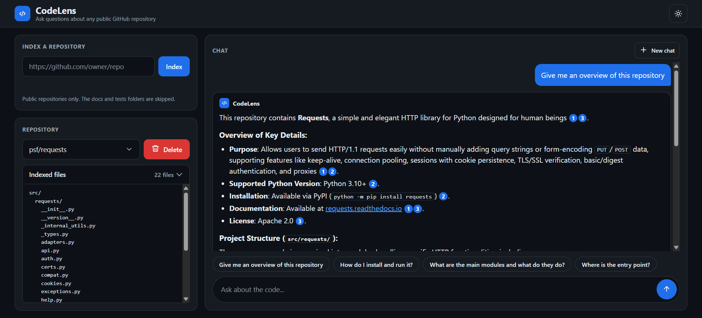
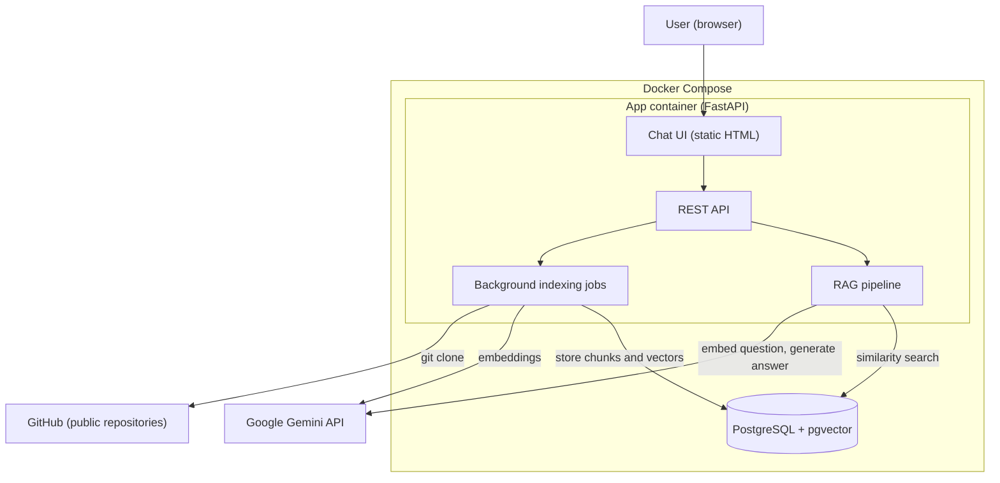
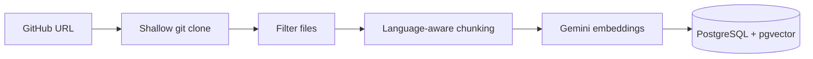
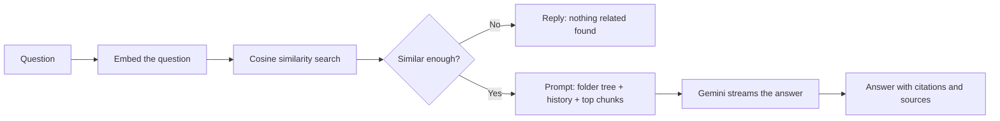

<h1 align="center">CodeLens</h1>

<p align="center">
  <b>Ask questions about any public GitHub repository and get answers with citations, file names and line numbers.</b>
</p>

<p align="center">
  
  
  
  
  
</p>

<p align="justify">
CodeLens is a Retrieval-Augmented Generation (RAG) application for codebases. Paste a public GitHub URL, let the background pipeline index the repository, and ask questions like <em>"Where is authentication handled?"</em> or <em>"How do I run this project?"</em>. Every answer streams in real time with exact file paths, line numbers, and direct GitHub links so you can verify the source code instantly.</p>

**Live demo:** _coming soon_

## 🧭 Table of Contents

- [✨ Features](#-features)
- [📸 Screenshots](#-screenshots)
- [🧱 Architecture](#-architecture)
- [🧠 How It Works](#-how-it-works)
- [🧰 Technology Stack](#-technology-stack)
- [📁 Project Structure](#-project-structure)
- [🚀 Getting Started](#-getting-started)
- [🔧 Configuration](#-configuration)
- [⚡ Keyboard Shortcuts](#-keyboard-shortcuts)
- [🔌 API Reference](#-api-reference)
- [🧩 Design Decisions](#-design-decisions)
- [🚧 Limitations](#-limitations)
- [🔮 Future Improvements](#-future-improvements)
- [📄 License](#-license)
- [👤 Author](#-author)

## ✨ Features

- **Index any public repository** from its GitHub URL, with a live progress bar.
- **Language-aware chunking:** code is split along function and class boundaries, not at random positions.
- **Answers with sources:** every answer lists the files and line numbers it used, with one-click links to GitHub.
- **Streaming answers** with a Stop button.
- **Conversation memory:** follow-up questions like "explain that in simpler words" work.
- **Folder tree context:** the model also sees the repository structure, so layout questions get useful answers.
- **Hallucination control:** the model answers only from retrieved code, and a similarity threshold skips the model call when nothing relevant is found.
- **Multiple repositories:** switch between them from a dropdown, or delete them.
- **Polished interface:** dark and light themes, responsive layout, markdown rendering, copy buttons and keyboard shortcuts.
- **One-command setup** with Docker Compose.

## 📸 Screenshots

<table>
  <tr>
    <td align="center"><b>Light mode</b><br></td>
    <td align="center"><b>Dark mode</b><br></td>
  </tr>
</table>

<p align="center">
  <b>An answer with numbered citations and sources</b><br>
  
</p>

## 🧱 Architecture



## 🧠 How It Works

**1. Ingestion (once per repository)**



**2. Question answering (every question)**



<p align="justify">
In plain words: the repository is cut into small pieces, and each piece is turned into a list of numbers (an embedding) that captures its meaning. A question is turned into numbers the same way, and the database finds the pieces whose meaning is closest. Only those pieces are sent to the language model, which is told to answer from them and nothing else.
</p>

## 🧰 Technology Stack

<p align="center">
  
  <br>
  
</p>

<details>
<summary>Technology details</summary>

| Layer | Technology | Used for |
|---|---|---|
| Backend | Python 3.11, FastAPI, Uvicorn | REST API, streaming responses, background jobs |
| Chunking | LangChain text splitters | Language-aware splitting of source code |
| AI | Google Gemini (`google-genai`) | Embeddings and answer generation |
| Database | PostgreSQL 16 with pgvector | Vector storage, HNSW index, cosine similarity search |
| Data access | SQLAlchemy, psycopg 3 | Queries and transactions |
| Repository access | Git, GitPython | Shallow clone of public repositories from GitHub |
| Frontend | HTML, CSS, JavaScript | Chat interface served by FastAPI, no build step |
| Packaging | Docker, Docker Compose | One-command setup |

</details>

## 📁 Project Structure

```
codelens/
├── app/
│   ├── main.py        # FastAPI routes and streaming responses
│   ├── config.py      # Settings loaded from environment variables
│   ├── db.py          # Tables, vector search, usage counters
│   ├── loader.py      # URL validation, git clone, file filtering
│   ├── chunker.py     # Language-aware splitting with line numbers
│   ├── embedder.py    # Gemini embeddings with batching and retries
│   ├── indexer.py     # Background indexing jobs and progress
│   ├── rag.py         # Retrieval, prompt building, answer streaming
│   ├── smalltalk.py   # Local replies to greetings (no API call)
│   └── static/
│       └── index.html # Chat interface
├── db/init.sql        # Enables the pgvector extension
├── docs/screenshots/  # Images used in this README
├── Dockerfile
├── docker-compose.yml
├── requirements.txt
└── .env.example
```

## 🚀 Getting Started

**Prerequisites**

- [Docker Desktop](https://www.docker.com/products/docker-desktop/) (running)
- [Git](https://git-scm.com/)
- A free Gemini API key from [Google AI Studio](https://aistudio.google.com/apikey)

**Run it locally**

```bash
git clone https://github.com/YOUR_USERNAME/codelens.git
cd codelens
```

Create your environment file (Windows PowerShell: `copy .env.example .env`, macOS/Linux: `cp .env.example .env`) and set your values:

```
POSTGRES_USER=codelens
POSTGRES_PASSWORD=choose_a_password
POSTGRES_DB=codelens
GOOGLE_API_KEY=your_gemini_api_key
```

Start everything:

```bash
docker compose up --build
```

Open **http://localhost:8000**, paste a public GitHub URL, press **Enter**, and start asking questions. Interactive API docs are at http://localhost:8000/docs.

To stop the app, press `Ctrl + C` and run `docker compose down`. Indexed data is kept in a Docker volume; add `-v` only if you want to delete it.

## 🔧 Configuration

| Variable | Purpose |
|---|---|
| `POSTGRES_USER`, `POSTGRES_PASSWORD`, `POSTGRES_DB` | Credentials for the database container |
| `GOOGLE_API_KEY` | Your Gemini API key |

The model names live in code: `EMBEDDING_MODEL` in `app/embedder.py` and `CHAT_MODEL` in `app/rag.py`. Google renames models from time to time, so if you see a "model not found" error, check the [current model list](https://ai.google.dev/gemini-api/docs/models) and update those two lines.

## ⚡ Keyboard Shortcuts

| Key | Action |
|---|---|
| `Enter` | Index a repository / send a question |
| `Up` / `Down` | Move between the input boxes |
| `/` | Focus the question box |
| `Esc` | Stop a streaming answer |
| `Alt + N` | New chat |
| `Alt + T` | Toggle theme |

## 🔌 API Reference

| Method | Endpoint | Description |
|---|---|---|
| `GET` | `/` | Chat page |
| `GET` | `/health` | Checks the database, pgvector and API key |
| `POST` | `/index-repo` | Starts indexing in the background and returns a `job_id` (`202`). Body: `{"repo_url": "https://github.com/owner/repo"}` |
| `GET` | `/index-jobs/{job_id}` | Status, stage and progress percent of an indexing job |
| `GET` | `/repos` | Lists indexed repositories |
| `GET` | `/repos/{owner}/{name}/tree` | Folder tree of the indexed files |
| `DELETE` | `/repos/{owner}/{name}` | Deletes a repository and its chunks |
| `POST` | `/ask` | Streams an answer as newline-delimited JSON events (`sources`, `token`, `done`, `error`). Body: `repo`, `question`, optional `history` |
| `GET` | `/usage` | Gemini requests made by this app today |

## 🧩 Design Decisions

- **Language-aware chunking** keeps functions and classes together, and each chunk stores its start and end line, which makes precise citations possible.
- **pgvector instead of a separate vector database:** one PostgreSQL instance holds vectors and metadata, so the setup stays small.
- **Similarity threshold:** unrelated questions never reach the language model, which reduces hallucinations and saves API quota.
- **Streaming with newline-delimited JSON:** sources arrive first, then the answer token by token.
- **Background jobs with polling:** indexing takes minutes, so it runs outside the request and the UI polls for progress.
- **Safe re-indexing:** old chunks are replaced only after the new embeddings succeed.
- **Quota awareness:** batched requests, retries with backoff, one indexing job at a time, and a clear message when the daily quota is reached.
- **Security basics:** only `https://github.com/owner/repo` URLs are accepted, symlinks in cloned repositories are never followed, and all model output is HTML-escaped before rendering. Secrets stay in `.env`, which is excluded from Git.

## 🚧 Limitations

- Only **public** repositories are supported.
- Repositories above **1500 chunks** are rejected to protect the free API quota, and `docs` and `tests` folders are skipped.
- Supported files: Python, JavaScript, TypeScript, Java, Go, Rust, C, C++, C#, Ruby, PHP and Markdown.
- Free Gemini tiers have per-minute and per-day limits, so large repositories can hit a rate limit.
- There are no user accounts; all indexed repositories are visible to everyone using the instance.

## 🔮 Future Improvements

- Support for private repositories (GitHub token)
- Hybrid search (keyword plus vector) and re-ranking
- Re-indexing only changed files
- User accounts and per-user repositories
- Automated tests and a CI pipeline

## 📄 License

Released under the MIT License. See [LICENSE](LICENSE) for details.

## 👤 Author

**Ankit Raj** · [GitHub Profile](https://github.com/ankitRaj925)